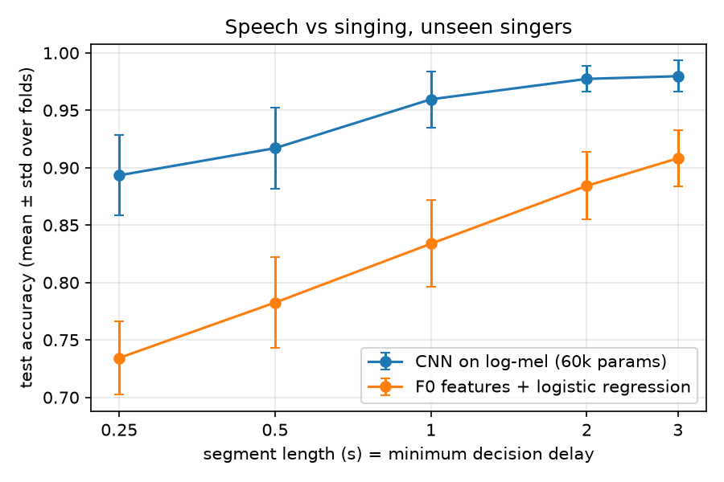

# vocal-classifier — speech vs singing, on singers the model has never heard

**Question.** How short can a voice snippet be and still be reliably classified as *speech* or *singing*?
That decides how fast a real-time system (e.g. a unified speech/singing voice converter) can switch modes.

## Method

| | |
|---|---|
| Data | NUS-48E: 12 singers each **read and sing** the same lyrics (169 min). Same person, same words -> the model must learn *how* the voice is used, not *who* or *what*. |
| Split | Speaker-independent 6-fold CV. Folds = the 6 singer pairs that share a song set. Fold k = test, fold k+1 = validation (early stopping), 4 folds = train. Each singer is tested exactly once; the test set is touched once per run. |
| Features | 16 kHz, log-mel 64 bins, 25 ms window, 10 ms hop. Segments of 0.25–3 s; segments that are >50 % silent are dropped. |
| Models | **F0 baseline**: 5 pYIN pitch features (voicing ratio, median pitch, pitch range, median glide, held-note ratio) + logistic regression. **CNN**: 4 conv blocks + global average pooling, per-example normalisation (loudness cannot be a shortcut), SpecAugment. Both models are scored on exactly the same segments. |
| Metrics | Accuracy, macro-F1, confusion matrix (mean ± std over 6 folds). Cost: params, MACs, single-thread CPU latency at batch 1 (50 warm-up, 500 timed runs, median and p95). |
| Generalisation | ccmusic chest/falsetto corpus (all sung, other singers, other studio): share predicted as "singing". |

**Total decision delay = segment length (waiting for audio) + compute time.**

## Run

```
python -m pytest -q                                 # 7 checks, no data needed
python -m vc.train --seg 1.0 --fold 0               # one quick run
python -m vc.train --seg 0.25 0.5 1 2 3             # full CV, all lengths
python -m vc.baseline_f0 --seg 0.25 0.5 1 2 3
python -m vc.eval_ccmusic --ckpt checkpoints/cnn_seg0.5_fold0.pt
python -m vc.eval_folder --ckpt checkpoints/cnn_seg1.0_fold0.pt --data data/own   # your own recordings
python -m vc.report                                 # table + results/accuracy_vs_length.png
```

Data layout: `data/nus-smc-corpus_48/<SINGER>/{read,sing}/*.wav`, `data/chest_falsetto/default/*/*.arrow`.

## Results

Speaker-independent 6-fold CV on NUS-48E, mean ± std over folds (run of 2026-11-09, seed 0).
A model that always answers "singing" gets about 71 % accuracy on this data.

| segment | F0 baseline acc. | CNN acc. | CNN macro-F1 | CPU latency, features + model |
|---|---|---|---|---|
| 0.25 s | 73.4 ± 3.2 % | 89.3 ± 3.5 % | 0.876 ± 0.032 | 2.5 ms |
| 0.5 s | 78.3 ± 4.0 % | 91.7 ± 3.6 % | 0.905 ± 0.033 | 4.3 ms |
| 1 s | 83.4 ± 3.8 % | 96.0 ± 2.5 % | 0.955 ± 0.025 | 6.3 ms |
| 2 s | 88.4 ± 2.9 % | 97.7 ± 1.1 % | 0.975 ± 0.012 | 10.5 ms |
| 3 s | 90.8 ± 2.4 % | 98.0 ± 1.4 % | 0.977 ± 0.015 | 13.9 ms |

CNN: 60,530 parameters, 19.2 M MACs per 1 s segment. Latency: one CPU thread, batch 1, median of 500 runs.



What the numbers say:

- The CNN on 0.25 s (89 %) matches the pitch-only baseline on 2 s (88 %): spectral detail buys roughly 8x shorter decisions.
- Compute (2–14 ms) is negligible next to the audio that must be waited for (250–3000 ms). Delay is set by segment length, not by the model.
- Accuracy saturates near 98 % from 2 s; below 1 s it drops and varies more between singers (± 3.5 %).
- Cross-dataset: all 1,280 ccmusic sung clips are labelled "singing" by the 0.5 s fold-0 model. That corpus has no speech, so this shows no false "speech" alarms on new singers; it says nothing about speech.
- Own recordings (Mandarin, other microphone, deliberately breathy / falsetto / off-key singing): 126 of 135 one-second segments correct; only 27 speech segments, so this is an anecdote, not a measurement.

Known weaknesses: validation scores swing strongly between epochs (2 validation singers, constant learning rate), and errors are one-sided per fold (e.g. fold 5 misses singing, fold 3 misses speech), which points to a per-singer shift of the decision threshold.

## Limits (stated honestly)

- 12 singers, non-professional, English pop songs only.
- Reading lyrics aloud ≠ spontaneous conversation.
- ccmusic clips are 0.5 s and have no singer IDs.
